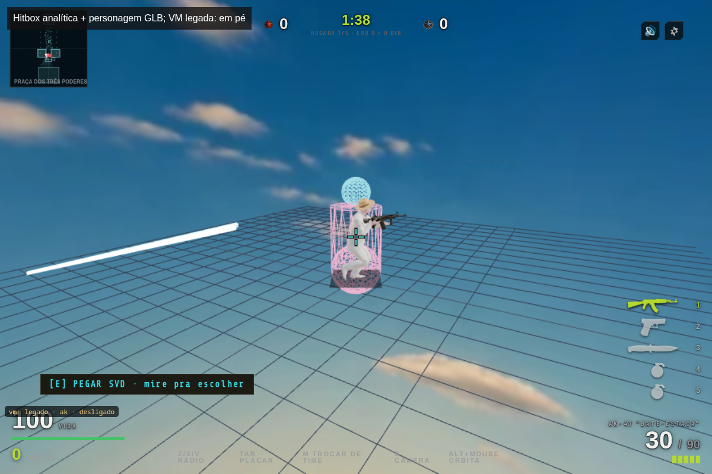
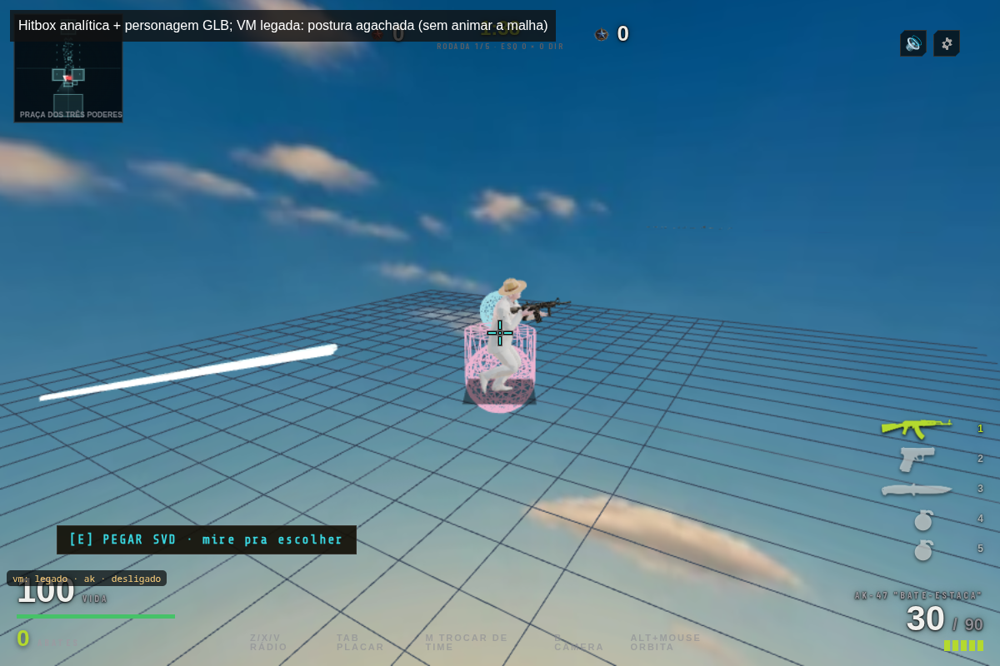
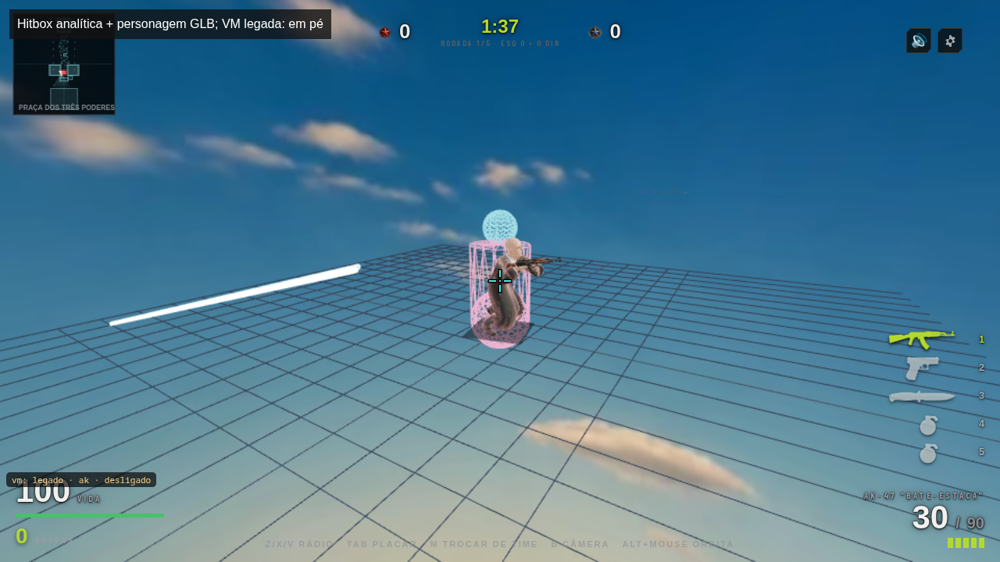
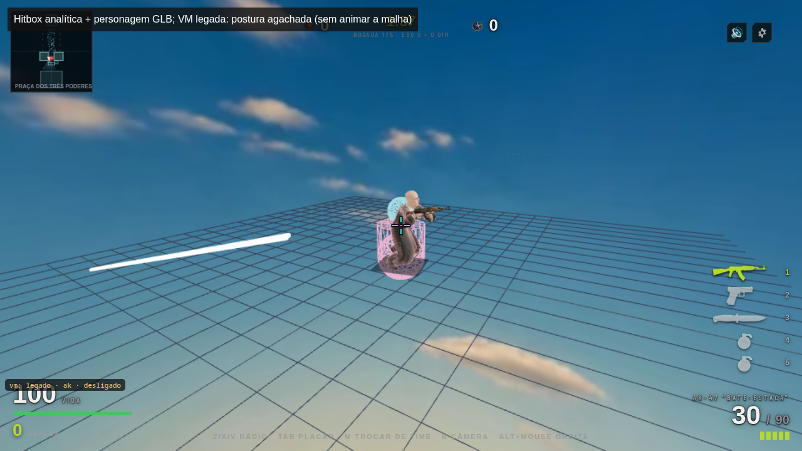

# Diagnóstico visual de balística

Capturas da classe Game real, em 3:2 e 16:9, com Chromium/SwiftShader e viewmodel legado explícito. O personagem GLB carregou. O manifesto registra o SHA do código capturado, pontos de nove raios da escopeta, quatro rastros e ausência de pageerror. O cenário foi isolado: mundo oculto, grade auxiliar, câmera fixa, dano desativado e volumes desenhados por diagnóstico. Banners transitórios foram ocultados.

Inspeção: o volume rosa envolve uma região mais larga que o corpo visível; a esfera azul da cabeça não coincide precisamente com a cabeça animada. Ao mudar crouchF, os volumes baixam enquanto a malha permanece na mesma animação. As figuras comprovam a diferença entre geometria uniforme e aparência; não aprovam sua correspondência artística. Os rastros visíveis se sobrepõem parcialmente no ângulo escolhido; sua contagem vem também do manifesto. O bot de cada proporção pode usar um personagem diferente.

Não é partida completa, benchmark, validação de ADS/spray, agachamento animado nem aceite do runtime autorado. Faltam assets privados de viewmodel e áudio local; o diagnóstico emite aviso de importação duplicada de Three.js ao adicionar a sobreposição. Essas limitações exigem QA e playtest antes de produção.

Para repetir, na raiz do cliente, inicie Astro em 127.0.0.1:4387 com devToolbar desativada e rode `NODE_OPTIONS=--max-old-space-size=768 node docs/qa/balistica/capture.mjs`. O script abre um único navegador, processa as proporções sequencialmente e grava em /tmp/corosolto-balistica-qa. Observe as figuras; não use apenas o manifesto como aceite.

