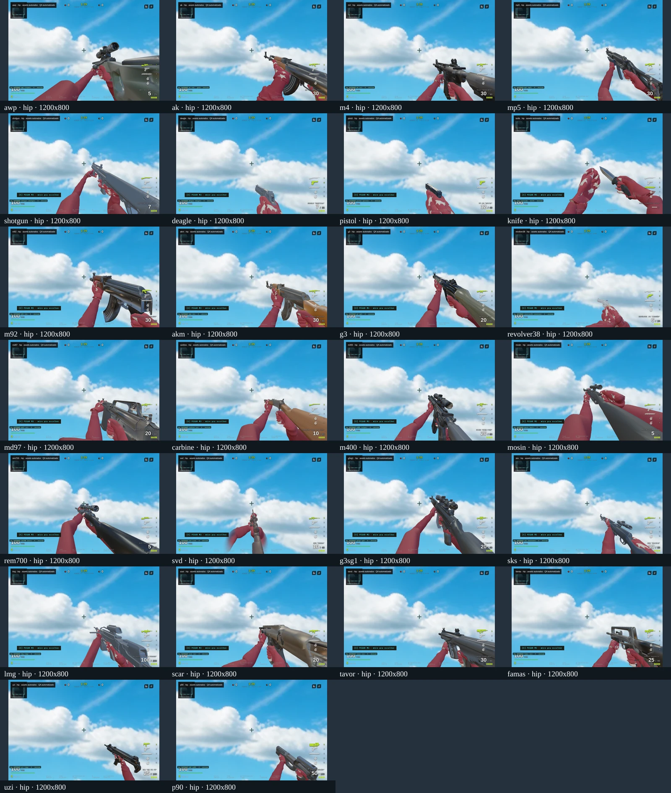
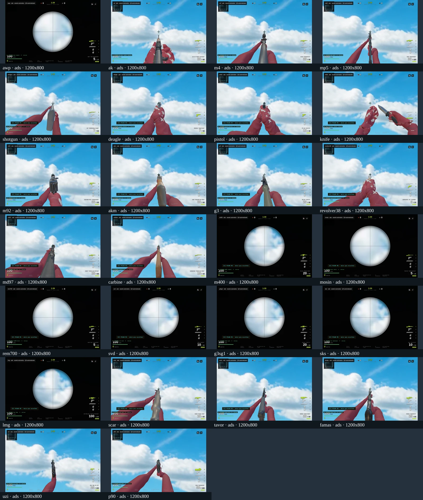
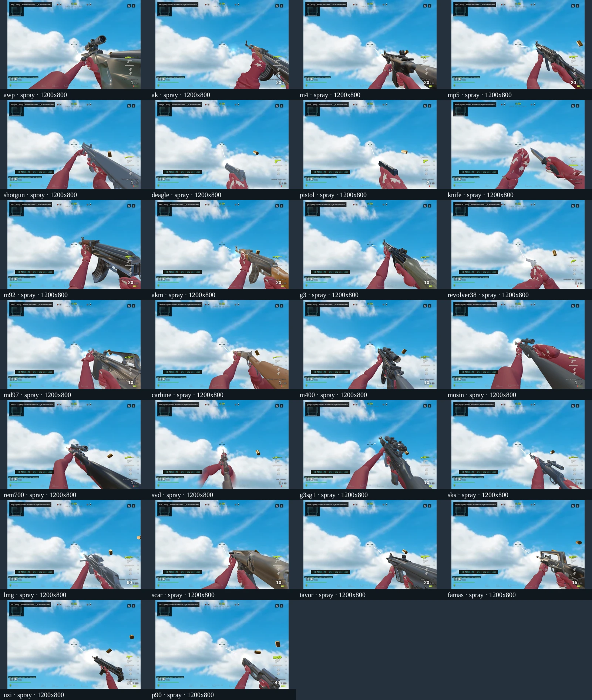
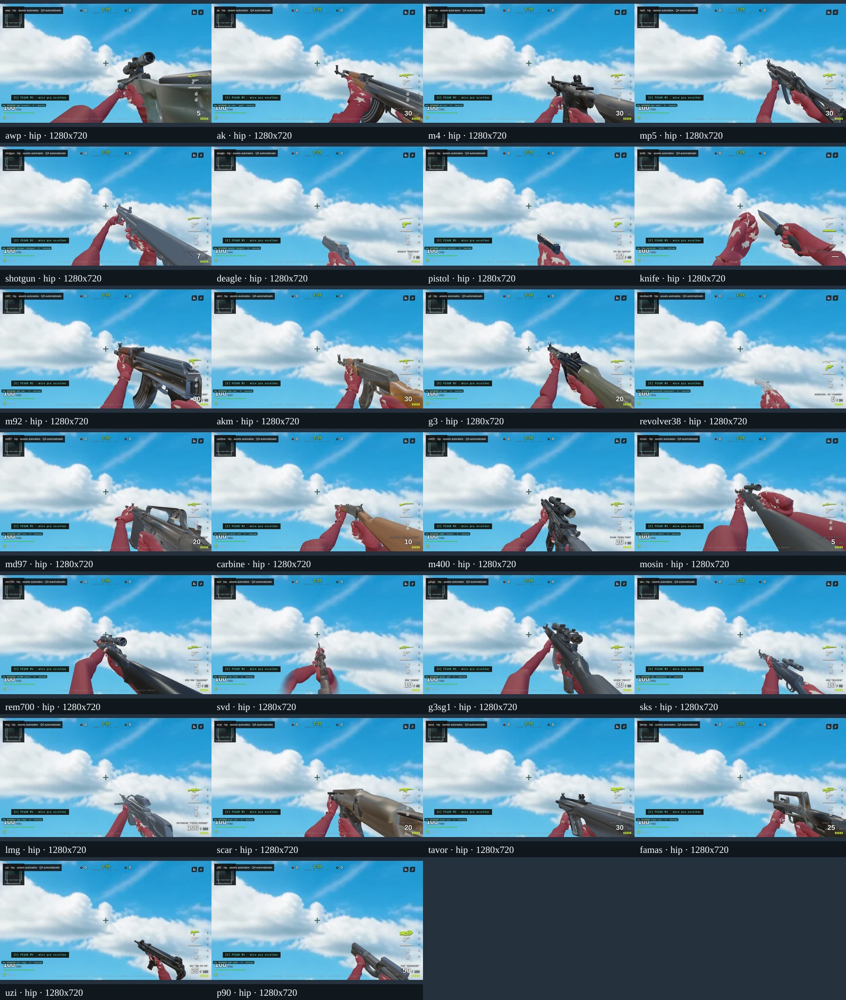
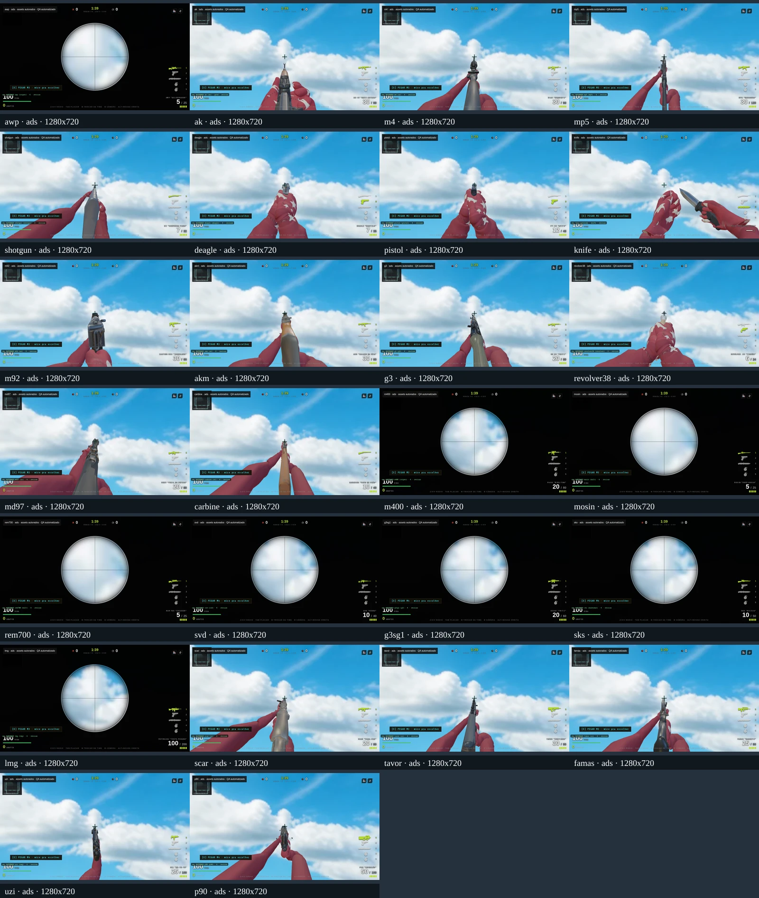
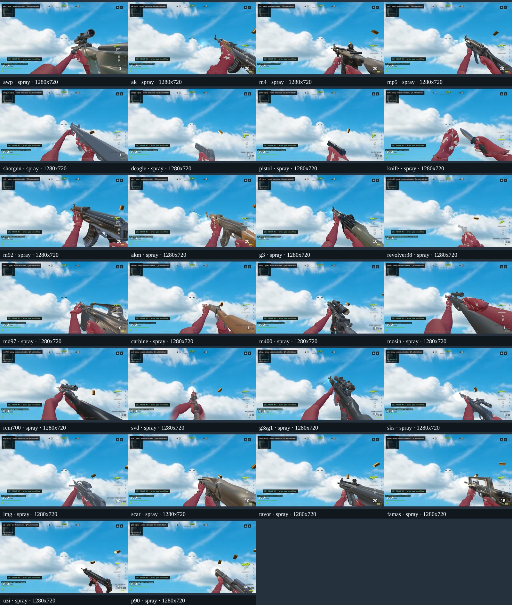

# QA autorado, TTK e dispersão — 15/10/2026

Foram verificados bytes e SHA-256 dos 63 arquivos do manifesto de assets (158,85 MiB). Os binários licenciados ficam fora do Git. As 156 capturas do runtime real cobrem 26 armas × hip/ADS/disparo × 3:2/16:9; todos os controladores autorados estavam ativos, sem exceções de página. O heap reportado ficou em aproximadamente 180–242 MiB. Isso é heap JS, não RAM total do navegador.

As capturas do arsenal usam a integração `916bc006c7b280e1132f70f7e644aae7be4b3795`. O cenário é isolado: mundo oculto, iluminação existente, um navegador/página por vez, quatro armas por página, atualização manual a 60 Hz e render de mundo + overlay VM. O disparo passa por `_tryShoot`; ADS por `_scope` e `_updatePlayer`. Não é benchmark de FPS, partida completa, teste de áudio ou aceite humano. A faca recebe um ataque; seu estado ADS continua bloqueado. As sheets WebP servem à triagem; os PNGs selecionados preservam o diagnóstico em resolução original.








## Agachamento animado

O bot GLB animava `crouch`, mas nunca atualizava `crouchF`: a consulta de hitbox e a origem do tiro continuavam em pé. A correção estabelece a postura antes do disparo tanto no roteiro quanto no NN, compartilha o olho com LOS e limpa postura no respawn e no início de round. O reset de round também foi reproduzido vermelho antes do ajuste. Modelos procedurais mantêm postura em pé; o update de remotos conserva o estado recebido. Não foi introduzida replicação nova de postura no protocolo.

No personagem Caminhoneiro assentado, o osso da cabeça baixa de 1,36746 para 0,84479 m: 0,52267 m, próximo da descida lógica existente de 0,52 m. Antes o olho ficava em 1,50 m mesmo agachado; depois fica em 0,98 m. São alturas relativas ao chão isolado. A postura lógica do bot é binária, enquanto a malha faz fade; os frames de transição não certificam coincidência contínua. Cosméticos e deslocamentos laterais não são hitboxes próprias.

| Estado | 3:2 | 16:9 |
|---|---|---|
| Antes, animação agachada e volume em pé | [PNG](before-1200x800-crouched.png) | [PNG](before-1280x720-crouched.png) |
| Depois, postura compartilhada | [PNG](after-1200x800-crouched.png) | [PNG](after-1280x720-crouched.png) |

O overlay desenha o torso truncado e a esfera da cabeça; omite a calota inferior dos pés. Não certifica encaixe exato de cada membro ou de todo o elenco. A régua real consulta raios acima da cabeça e na cabeça agachada, LOS com cobertura baixa, primeiro disparo, volta em pé, respawn, countdown e fronteiras procedural/remoto. Os três mutantes retiram postura, fixam altura do olho e omitem reset de round.

## Ensaio automatizado de tiro

`tools/eval/ballistics-range-playtest.mjs` mede os consumidores reais de gatilho, cone, recuo, geometria e dano, com alvo de 100 HP parado e sem cobertura. São 25 armas de fogo × 3/12/30 m × hip/ADS/ADS agachado × compensação perfeita ou nenhuma, com 100 sementes reutilizadas por célula: 450 células, 45.000 tentativas, não 45.000 cenários independentes.

TTK começa no primeiro disparo e termina no disparo fatal, excluindo aquisição, saque e reação. Zero significa morte no primeiro tiro. O limite é dez segundos ou o fim de um pente. Os percentis `ttkAmongKillsP50/P90` são condicionais aos abates e devem ser lidos junto de `kills/trials` e dos dois motivos de censura. Semi recebe clique ideal a cada oportunidade de 120 Hz; ADS começa completo e é reativado após descope. A compensação cancela perfeitamente o recuo anterior. Isso não mede dificuldade humana, latência, movimento, regen ou feedback audiovisual.

A dispersão comparável é outra execução, com alvo não eliminável e exatamente cinco disparos por tentativa: 225.000 disparos e 297.000 raios. `coneRadiusP90` mede abertura relativa à mira, projetada perpendicularmente a ela na distância declarada; `absoluteRadiusP90` inclui deriva do recuo no plano do alvo. Ambos usam todos os cinco disparos. `hits` conta impactos/pellets; `shotsWithHit` conta disparos com pelo menos um impacto. Não dividir impactos por disparos como taxa de acerto de shotgun. FX principais estão desativados, mas o sorteio cosmético de `kickSide` permanece.

Dados completos: [TTK](range-playtest.json), [cinco disparos](fixed-five-dispersion.json). A nuvem de raios da execução TTK sofre parada dependente do abate; use a execução fixa para comparação de dispersão. Esses dados não aprovam, sozinhos, justiça ou realismo do arsenal.

## Três rajadas abaixo de três segundos

A amostra padrão foi reproduzida com `SIM_DUEL=1`: nove sementes, quatro mapas, 60 s. A instrumentação adicional preserva a média de vida de 12,107 s/10 mortes e as três rajadas saudáveis curtas. Foram registrados todos os disparos nas respectivas janelas, inclusive erros, origem/direção e tokens. Máximo de dois holders simultâneos; zero disparos contra o jogador fora da quota.

| Semente, Ferro Velho | Janela | Impactos fatais |
|---|---:|---|
| 777 | 2,817 s | quatro P90 de 14 + três M4 de 20 |
| 777, outra vida | 2,450 s | dois M4 de 20 + quatro P90 de 14 + um AK de 23 |
| 8675309 | 0,767 s | DE: 67 na cabeça + 33 no corpo |

O segundo caso tem três atacantes ao longo da janela, compatível com rodízio de tokens; não eram três permissões simultâneas. Cadência e dano observados cabem nas fórmulas existentes. A revisão independente não encontrou justificativa para nerfar armas somente para apagar esses registros. Isso também não prova que todo encontro oferece reação perceptível suficiente: faltam exposição, aviso audiovisual, cobertura disponível e avaliação humana. [Trace das janelas](short-bursts-detail.json).

## Viewmodels: análise antes de alterar

Nenhum viewmodel, malha, montagem ou animação foi alterado nesta rodada. As vistas laterais e inferiores adicionais analisam o produto existente; a câmera diagnóstica muda apenas na instância local de QA.

- Faca: seção do cabo atravessa a superfície da palma em idle, pico e recuperação da estocada. O punho também apresenta abertura e abas esticadas. Prioridade para corrigir a relação mão–cabo no produto, preservando a trajetória e verificando todos os clipes. [Idle](knife-idle-underside.png), [pico](knife-attack-peak-underside.png), [recuperação](knife-attack-end-underside.png).
- .38: a barra do guarda-mato aparenta interferir no índice nas vistas frontais inferiores, inclusive disparando. Revisar essa região em 3D. [Vista](revolver38-idle-front-lower.png).
- DE/PT-38: o enquadramento em 16:9 corta parte da pega. As vistas opostas mostram dedos em torno do cabo e índice no guarda-mato; não confirmam arma flutuando nem penetração geral do cabo. A Deagle tem contato comprimido nessa região. Não mover a arma dentro da mão sem medição adicional. [DE](deagle-idle-opposite.png), [PT-38](pistol-idle-opposite.png).
- A triagem também apontou alinhamento de mira/pegada da AK, peças aparentes da P90 e pegada da Mosin. São pendências de inspeção, não regressões demonstradas contra baseline.

DE/PT-38/.38 usam produtos `baked`: alterar frame move arma e mãos juntas e não resolve relação interna incorreta. O gate existente da Deagle passou, mas mede menor distância não assinada entre algum vértice de cada dedo e qualquer triângulo da arma, só no idle. Não identifica penetração, região anatômica ou área de contato. Drift zero entre origens também admite pegada rigidamente errada. O verde desse gate não substitui as vistas.

Revisores independentes inspecionaram fontes, método e pixels sem construir os assets. As demais armas receberam triagem, não aceite integral de contato. Não houve merge, deploy ou promoção de asset privado.

## Reprodução

Na raiz do cliente, com assets verificados disponíveis no caminho de serving e Astro local em 127.0.0.1:4387:

```sh
NODE_OPTIONS=--max-old-space-size=768 node docs/qa/balistica/autorado/capture-authored.mjs
NODE_OPTIONS=--max-old-space-size=768 node docs/qa/balistica/autorado/capture-posture.mjs after
NODE_OPTIONS=--max-old-space-size=768 node tools/eval/ballistics-range-playtest.mjs
NODE_OPTIONS=--max-old-space-size=768 node tools/eval/ballistics-range-playtest.mjs --fixed-five
npm run eval:bot-crouch-geometry
```

Execute em série. `BALLISTICS_QA_OUT` escolhe a saída externa; os scripts não removem o diretório. O rótulo `before` da captura de postura não restaura código: para baseline, sirva um checkout isolado do SHA registrado. Observe as figuras e o manifesto, sem confundir controlador ativo com qualidade visual aprovada.
