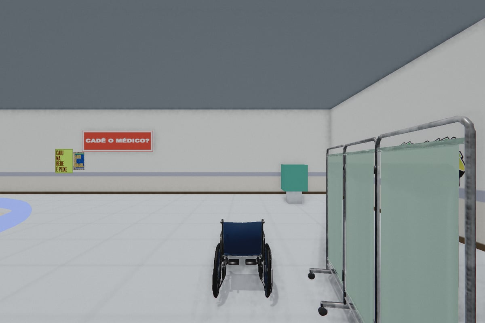
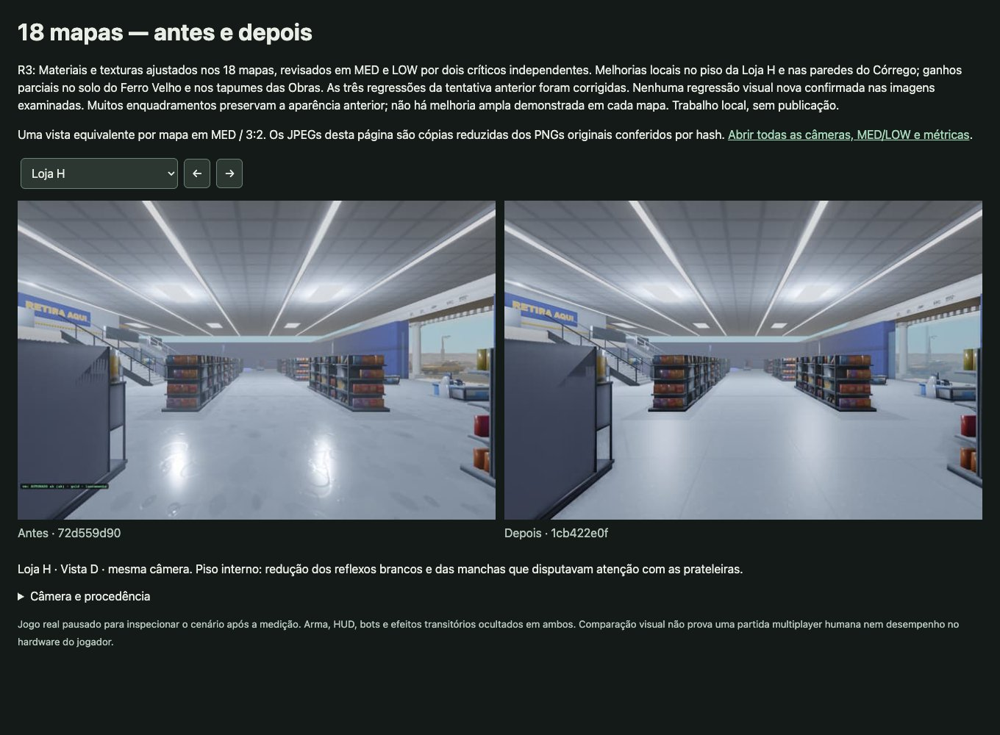

# UPA e superfícies dos mapas: evidência do PR

A UPA volta à seleção e à rotação com 9 props clínicos gerados no Mint.gg. O lote também corrige tiros contra proxies invisíveis e grafites sem parede, além de ajustar texturas e materiais nos 18 mapas.

## Imagens

UPA, MED 3:2, pose c do renderer real. Captura na fonte de runtime `1cb422e0f685706658bb5bae472ddc8fd831a8c4`. PNG original 1500×1000, SHA-256 `09939901efbdbf9f0a5aaa056dd882a0d9ca27c55f58c8c7ac85cd51f94b2314`; JPEG de revisão 1200×800, sem mudança de composição ou tratamento de cor.

Comparação local da Loja H: baseline `72d559d90` e R3 `1cb422e0f`, câmera igual. A revisão independente confirmou redução dos reflexos e das manchas concorrentes no piso.

## Validação medida

- Build aprovado e 23 verificações focadas aprovadas na fonte R3.
- Grafites: auditor de navegador nos 18 mapas em MED e LOW, 2.180 quads e 16 pinturas nativas, 54.500 pontos por perfil, zero rejeitados; 4 mutantes detectados.
- Tiros: backend pareado com a fonte R3, zero diferenças em 6.912 raios e buffers dos 175 templates GLB iguais ao cliente.
- Dois críticos independentes revisaram 216 PNGs candidatos, MED 3:2, MED 16:9 e LOW 3:2. Os diagnósticos da Penitenciária fixaram tempo e as 4 luzes. Nenhuma regressão material nova demonstrada.
- Ganhos confirmados são locais: Loja H e Córrego; ganhos parciais em Ferro Velho e Obras. Muitos enquadramentos preservam o baseline. A revisão não demonstra upgrade amplo em cada um dos 18 mapas.

## Limites para promoção

Staging, gameplay humano e performance repetida em hardware isolado continuam pendentes. WebGL1/textureLod, HTTP404 e falhas de gates herdadas não são tratados como aprovados. O backend pareado é a lane local `codex/mp-map-shot-geometry-20261011`, checkpoint `2a64491916fe287b6e5c9ee26f9d69a69415464b`, com Dockerpin R3; sua promoção precisa acompanhar o cliente.

[Origem e integração Mint](UPA-MINT-INTEGRACAO-20261011.md) · [Retorno da UPA](UPA-RETORNO-20261011.md) · [Suporte dos grafites](GRAFITES-SUPORTE-20261011.md) · [Oclusão dos tiros](TIROS-OCLUSAO-20261011.md).

Preparado com assistência de OpenAI Codex (GPT-6). Revisar o SHA atual em staging antes de promover o lote.

## Correção do contrato em checkout limpo

O primeiro CI do PR816 falhou com ERR_MODULE_NOT_FOUND para three: o import estático de graffiti_pass.js em map-contrato-check.mjs era resolvido antes de harness.mjs criar a ponte para a engine vendorizada. A correção aguarda o harness e usa import dinâmico nessa entrada do teste. A árvore isolada reproduziu a falha antes e aprovou MC1/MC2/MC3 nos 18 mapas depois, sem npm install ou dependência de checkout vizinho. Fontes de runtime e assets permanecem iguais à R3 capturada.
